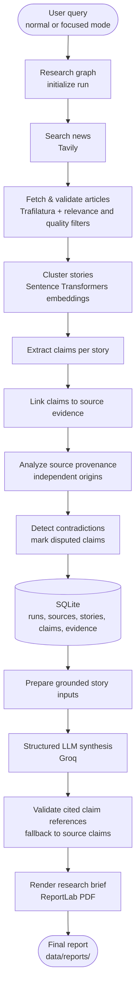

# Football Intelligence

Football Intelligence turns a football news question into a source-linked research brief. It searches current news, filters and groups articles into stories, checks claims against their sources, and exports a PDF report.

## Architecture

The workflow is a sequential LangGraph pipeline. Each stage adds structured evidence to a shared research state; the synthesis and PDF steps run after the research graph completes.



The search and article-processing stages reject irrelevant or low-quality results, normalize URLs, and remove duplicate articles. Semantic clustering groups coverage of the same event. Claim statuses reflect source support and independence; clear polarity conflicts are marked as disputed. SQLite retains the run and its source-to-story-to-claim evidence links. The synthesis step uses those claims as its input and checks generated lines against cited claims, falling back to claim text when needed.

## Run locally

Requirements: Python 3.11 or newer and [uv](https://docs.astral.sh/uv/).

1. Install dependencies:

   ```powershell
   uv sync
   ```

2. Copy `.env.example` to `.env` and set `TAVILY_API_KEY` and `GROQ_API_KEY`. The remaining settings have defaults in the application.

3. Start the interactive CLI:

   ```powershell
   uv run football-intelligence
   ```

Enter a query, then choose normal broad news or focused research. Press Enter at the query prompt for today's football news. The completed PDF is written to `data/reports/`.

## Configuration

| Setting | Purpose |
| --- | --- |
| `TAVILY_API_KEY` | News search and article-result retrieval |
| `GROQ_API_KEY` | Structured, claim-grounded brief synthesis |
| `GROQ_MODEL` | Groq model name; defaults to `openai/gpt-oss-120b` |
| `TAVILY_MAX_RESULTS` | Maximum collected results (default `20`, range `1`–`100`) |
| `DATABASE_PATH` | SQLite database location (default `data/football_intelligence.db`) |
| `APP_NAME` | CLI application name |
| `ENVIRONMENT` | Environment label |
| `REQUEST_TIMEOUT_SECONDS` | Configured request timeout |

The semantic clustering model (`all-MiniLM-L6-v2`) is loaded by Sentence Transformers on first use.

## Project layout

```text
src/football_intelligence/
  research.py       LangGraph search, article processing, claims, and persistence
  claims.py         Claim extraction and evidence-status decisions
  clustering.py     Semantic story grouping
  provenance.py     Source-origin grouping and comparison
  synthesis.py      Grounded structured brief generation
  database.py       SQLite schema and connections
  pdf_report.py     PDF report rendering
  main.py           Interactive command-line entry point
config/             Source and application configuration
data/reports/       Generated research briefs
tests/              Automated tests
```

## Development

Run the test suite with `uv run pytest` and lint with `uv run ruff check .`.
